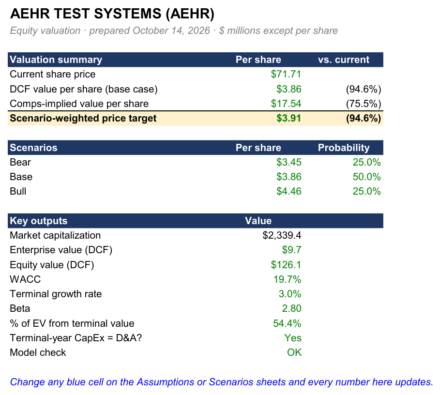
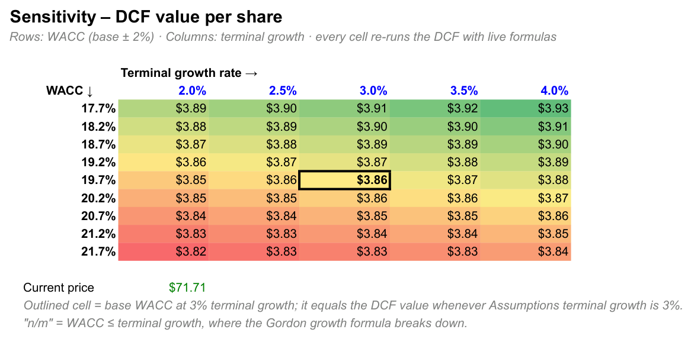

# EDGAR Equity Valuation Model

A Python CLI that pulls a company's **reported financials straight from SEC EDGAR** and builds a working Excel valuation model with a **DCF**, **comparable companies**, and a **scenario-weighted price target**. All of it is driven by **live Excel formulas**. Change any blue assumption and the price target updates.

```bash
python valuate.py AEHR --peers TER,COHU,FORM,KLIC
# -> output/AEHR_valuation_2026-10-14.xlsx
```

No paid data, no API keys: SEC's free XBRL API for fundamentals, `yfinance` for prices.

| Summary | Sensitivity |
|---|---|
|  |  |

---

## Quick start

Python 3.11+.

```bash
python -m venv .venv
.venv\Scripts\activate          # macOS/Linux: source .venv/bin/activate
pip install -r requirements-dev.txt
python valuate.py AEHR --peers TER,COHU,FORM,KLIC
pytest                          # 22 tests, fully offline
```

Every SEC and price response is cached in `cache/`, so reruns on the same day are instant and offline. Tested on AEHR, TER and MSFT with no code changes. `python valuate.py MSFT --peers GOOGL,ORCL,AMZN,CRM` also works.

## What's in the workbook

| Sheet | What it shows |
|---|---|
| **Summary** | Current price, DCF value, comps value, scenario-weighted target, upside/downside. Every number is a formula referencing other sheets. |
| **Historicals** | 5 fiscal years of reported line items. Each row lists the XBRL tag it came from, so every number can be traced back to the filing. Growth and margins are formulas. |
| **Assumptions** | Every input in one place. Blue = input you can change, black = formula, green = link to another sheet. Each default comes with a note on how it was derived. |
| **DCF** | 5-year projection → unlevered free cash flow → WACC (CAPM) → terminal value → enterprise value → equity value per share. |
| **Sensitivity** | Value per share across WACC (±2%) × terminal growth (2–4%). Each of the 45 cells is its own DCF formula; color-scaled. |
| **Beta Regression** | OLS of weekly stock returns on the S&P 500 (statsmodels), cross-checked against Excel's own `SLOPE`/`RSQ`/`LINEST`, with a scatter chart and fit line. |
| **Comps** | Peer market cap, EV, EV/Revenue, EV/EBITDA, P/E; median and mean; peer medians applied to the target's metrics. |
| **Scenarios** | Bear / base / bull, each a full DCF with its own growth and margin, weighted by probability into the price target. |
| **Data Notes** | Missing tags, fallback tags used, assumptions, excluded peers, data sources, pull timestamp. |

---

## How the model works

### 1. Getting clean annual numbers from EDGAR

Companies file financial statements in XBRL, a machine-readable format in which every number carries a tag like `NetIncomeLoss`. SEC's `companyfacts` API returns every value a company has ever tagged. That's messier than it sounds:

- **A 10-K contains more than the year it covers.** It includes prior-year comparatives and sometimes quarterly figures. AEHR's 10-K tags a *quarter* ending Feb-2022 as `fp = FY`. So I keep only `form = 10-K, fp = FY` facts whose period runs **350–380 days** (a 52/53-week year is 364 or 371).
- **Restatements:** the same period gets reported again in later filings, so I keep the **most recently filed** value.
- **Tags change over time:** revenue moved from `SalesRevenueNet` to `RevenueFromContractWithCustomer…` under ASC 606. Each line item has an ordered list of fallback tags, and the fallback is chosen **year by year**. The tag actually used is shown on the Historicals sheet.
- **Missing data never crashes the run.** The cell stays blank and the gap is logged on Data Notes.

### 2. Default assumptions come from the company's own history

| Input | Default | Why |
|---|---|---|
| Revenue growth | Historical CAGR in Year 1, **fading linearly to terminal growth by Year 5** | Unusually high or negative growth doesn't last forever. Fading to the terminal rate keeps Year 5 consistent with the steady state the terminal value assumes. |
| EBITDA margin, D&A %, CapEx % | **Revenue-weighted** 5-year averages (Σ EBITDA ÷ Σ revenue) | One small, unusual year shouldn't dominate the average. |
| Tax rate | Effective rate over profitable years, clamped to 0–30% | AEHR's FY2024 rate was −166% (a one-time valuation-allowance release). Unclamped, that would be nonsense. |
| Beta | Regression beta (below) | Company-specific market risk. |
| Risk-free 4.25%, ERP 5.5%, terminal growth 3% | Market conventions | All editable. |

These are starting points, not forecasts. The model is meant to be argued with.

### 3. The DCF

A company is worth the present value of the cash it will generate for **all** capital providers:

```
EBITDA                = Revenue × EBITDA margin
EBIT                  = EBITDA − D&A
NOPAT                 = EBIT − taxes          (taxes only on positive EBIT)
Unlevered FCF         = NOPAT + D&A − CapEx
PV                    = FCF / (1 + WACC)^t     (end-of-year discounting)
```

**Discount rate (WACC).** Cost of equity comes from CAPM: `rₑ = r_f + β × ERP`. Debt is weighted in at book value and a 6% pre-tax cost, taxed: `r_d × (1 − t)`. If debt is under 5% of total capital, it's treated as immaterial and the WACC is all-equity. The threshold is an input.

**Terminal value (Gordon growth).** Cash flows after Year 5 are captured as a growing perpetuity:

```
TV = FCF₅ × (1 + g) / (WACC − g)
```

The terminal-year FCF sets **CapEx = D&A** (a switch on Assumptions). In steady state a company only replaces what wears out. Carrying an investment-phase CapEx ratio forever implies endless net investment for only 3% growth. With the switch on, MSFT's value moves from $172 to $252 because its recent AI capex runs at 3× D&A. The DCF sheet also shows the **% of EV from the terminal value** and the **implied exit EV/EBITDA**, two standard checks on whether the terminal value is reasonable.

**From enterprise value to price.** `Equity value = EV − debt + cash`, then divide by shares outstanding (the latest filing's cover-page count; basic, not diluted).

### 4. Sensitivity

The two least certain inputs are WACC and terminal growth. Each cell in the grid re-runs the DCF in one formula (`SUMPRODUCT` over the projected cash flows plus a re-discounted terminal value), so the table stays live. It doesn't need Excel's Data Table feature, and anyone can read the formula. Cells where WACC ≤ g show "n/m", because the Gordon formula breaks down there.

### 5. Beta

Two years of weekly returns for the stock vs the S&P 500, regressed with OLS. Weekly data (instead of daily) cuts noise from thin or non-synchronous trading in small caps. The sheet reports R², the standard error and a 95% confidence interval, plus the **Blume-adjusted beta** (0.67β + 0.33) as a reference. AEHR's β = 2.80 has R² = 0.16 and a confidence interval of roughly 1.6–4.0, so it is a noisy estimate. The input is blue, so a user can override it.

### 6. Comparable companies

```
Market cap = price × shares          EV = market cap + debt − cash
```

The **median** multiple is applied to the target's own metric, and the average of the meaningful methods becomes the comps value. A multiple is **n/m** (excluded) when its denominator is negative or missing, or when it exceeds a **100x outlier cap** (editable). The cap matters. KLIC's net income was $0.2M in a cyclical trough year, which gives a P/E of 20,762x. When only two peers have positive earnings, the "median" is just their average, and without the cap TER's comps value came out at $12,745/share. I added **EV/Revenue** to the spec's EV/EBITDA and P/E because it's the only multiple that works for a loss-making target like AEHR.

### 7. Scenarios

Base links to the Assumptions sheet. Bear and bull default to the base case ∓ 5 points of growth and margin, and they're editable. Each runs its own full DCF. The price target is the probability-weighted average (25/50/25 by default), normalized so the probabilities don't have to sum perfectly.

---

## Reading the AEHR result

On the 2026-10-14 data, the model gives **$3.91** (DCF/scenarios) and **$17.54** (comps) against a **$71.71** share price. The math is verified (see Testing). The gap comes from the inputs, and explaining it is the point of the exercise:

- **History looks backward.** AEHR's revenue fell for two straight years (−11%, −15%) and EBITDA turned negative. Defaults built on that history can't see the recovery the market is pricing in.
- **The cost of capital is high.** With β = 2.80, CAPM gives a 19.7% WACC.
- **AEHR trades at 44.5x revenue** against a peer median of 9.1x.
- **Most of the DCF value is cash.** $116M of cash against a $9.7M DCF enterprise value is why the sensitivity grid barely moves.

A good next step is to work backwards: on the Scenarios sheet, find the growth and margins that would justify ~$72.

## Simplifications (and how I'd extend them)

- **Latest fiscal year, not LTM.** Peers' fiscal year-ends differ (AEHR's ends in May, most peers in December). LTM would need 10-Q stitching.
- **No working-capital line** in free cash flow. An easy extension: ΔNWC as a % of incremental revenue.
- **End-of-year discounting**, not mid-year. No stub period between fiscal year-end and today.
- **Book debt, not market value.** Leases and stock-based compensation aren't adjusted, and shares are basic rather than diluted (no treasury-stock method for options).
- **Single EBITDA margin** across the projection, rather than a margin ramp.

---

## Testing

```bash
pytest
```

The 22 tests run **offline** against `tests/fixtures/`: real SEC and yfinance responses captured on 2026-10-14 and trimmed by `tools/make_fixtures.py`.

| Test | What it proves |
|---|---|
| `test_extract.py` | Picks the right tag, fallbacks resolve per year, restated values keep the latest filing, quarterly and 10-Q facts are excluded, a missing tag gives a blank cell plus a Data Notes entry (not an exception). |
| `test_beta.py` | statsmodels beta matches `numpy.polyfit` within 1e-6; a synthetic series with a known beta of 1.5 recovers it. |
| `test_dcf.py` | The Python DCF matches a hand-worked example. Then the **real workbook formulas** are evaluated with the pure-Python [`formulas`](https://github.com/vinci1it2000/formulas) engine and must match the Python model (to 1e-9, far tighter than the $0.01 spec). Raising terminal growth must change the Summary target. No cell may evaluate to an Excel error. |
| `test_comps.py` | EV math, negative and outlier multiples excluded, implied value per share, bad peer tickers skipped with a note. |

The workbook test caught a real problem during development. AEHR's value is mostly cash, so a +1% error in the terminal value moves value per share by only $0.002, which slipped under a $0.01 tolerance. I tightened the tolerance after deliberately breaking the formula and watching the test still pass.

**Verifying in real Excel (Windows).** `powershell -File tools/excel_verify.ps1 -Path output/<file>.xlsx` recalculates in Excel, counts formula errors on every sheet, and checks that changing terminal growth and the CapEx switch flows through to the Summary. Run on AEHR, TER and MSFT: 0 errors. `tools/render_sheets.py` produced the screenshots above.

## Project structure

```
valuate.py            CLI entry point; build_model() assembles every input
edgar/client.py       SEC fetch + on-disk cache + rate limit (User-Agent, ≤10 req/s)
edgar/extract.py      XBRL tag fallback logic -> tidy 5-year table + Data Notes
model/assumptions.py  default assumptions and bear/bull scenarios from history
model/beta.py         OLS beta regression (statsmodels)
model/comps.py        peer data, multiples, n/m rules, implied value
model/dcf.py          pure-Python reference DCF/WACC (what the tests check Excel against)
model/prices.py       yfinance prices, cached per ticker per day
excel/writer.py       builds every sheet with live formulas and named ranges
excel/styles.py       banker formatting conventions
tests/                pytest, offline against tests/fixtures/
tools/                fixture builder, Excel verification, screenshot renderer
```

## Data sources

- **SEC EDGAR:** `company_tickers.json` (ticker → CIK) and the XBRL `companyfacts` API. Every request sends a descriptive User-Agent and stays under SEC's 10 requests/second fair-access limit.
- **yfinance:** current price and 2 years of weekly adjusted closes for the stock and `^GSPC`.

*This is an educational model, not investment advice.*
